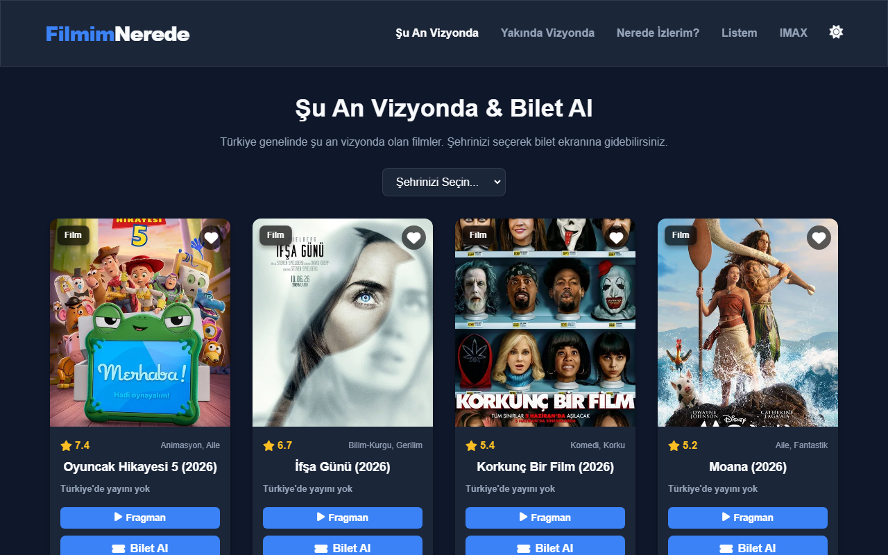
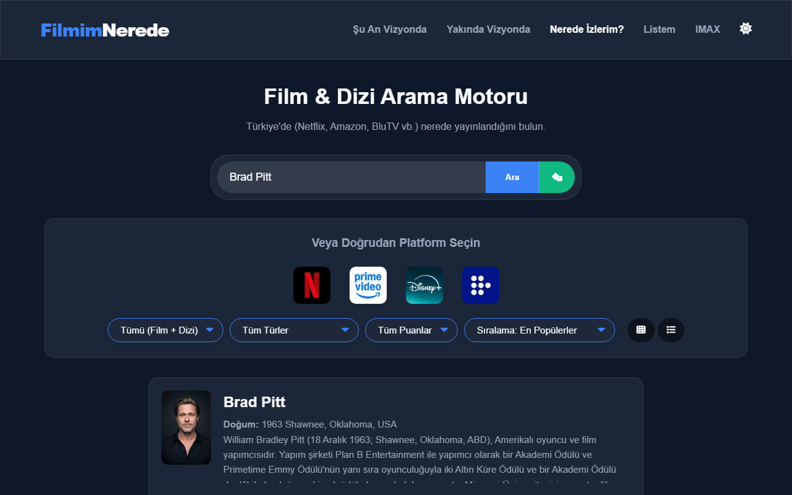

# 🎬 FilmimNerede - Premium Film & Dizi Rehberi

FilmimNerede, **The Movie Database (TMDB) API** entegrasyonu ile çalışan; modern, dinamik ve kullanıcı dostu bir film/dizi keşif uygulamasıdır. Kullanıcıların aradıkları yapımların Türkiye'de hangi yasal platformlarda (Netflix, Prime Video, Disney+, HBOMax vb.) yayınlandığını bulmalarını kolaylaştırır.

Uygulama, modern web tasarımı trendleri (glassmorphic UI, karanlık/aydınlık tema) ve pürüzsüz micro-animasyonlar ile tamamen **Vanilla JS (Saf JavaScript)**, **HTML5** ve **CSS3** kullanılarak geliştirilmiştir.

## 🚀 Canlı Demo
> Web uygulamasını canlı olarak deneyimlemek için buraya tıklayabilirsiniz: [https://filmimnerede.netlify.app/](https://filmimnerede.netlify.app/)

---

## ✨ Özellikler

- 📺 **Platform Entegrasyonu:** Netflix, Prime Video, Disney+, BluTV ve HBO Max (TMDB verisiyle) gibi platformlara göre anlık içerik filtreleme.
- 🔍 **Akıllı Arama ve Otomatik Tamamlama:** Yazmaya başladığınız an oyuncu, film ve dizi önerileri sunan dinamik arama motoru.
- 🌓 **Karanlık / Aydınlık Tema:** Kullanıcı tercihine göre değişen ve tarayıcı hafızasında saklanan modern renk temaları.
- 🎭 **Detaylı Oyuncu Profilleri:** Oyuncuların fotoğraflarını, biyografilerini, doğum bilgilerini ve yer aldıkları yapımları **"Başrol Rol Oranına"** göre listeleyen gelişmiş sıralama algoritması.
- ❤️ **Kişisel İzleme Listesi (Watchlist):** Beğendiğiniz yapımları tarayıcı hafızasında (Local Storage) saklayarak kendi listenizi oluşturma imkanı.
- 🎲 **Bana Film Öner! (Sürpriz Yapım):** TMDB veritabanında en az 1000 oy almış kaliteli yapımlardan tamamen rastgele seçim yapan sürpriz algoritması.
- 🗺️ **Türkiye IMAX Salonları Haritası:** Etkileşimli SVG haritası üzerinde Türkiye'deki IMAX salonlarının lokasyonlarını ve detaylarını görebilme.
- 🍿 **Fragman Oynatıcı:** YouTube API entegrasyonu sayesinde modal pencereden çıkmadan fragman izleyebilme.

---

## 🛠️ Teknolojiler ve Yapı

Uygulama, herhangi bir ağır framework (React, Vue vb.) kullanılmadan, performans ve hız odaklı olarak **Vanilla JS** ile geliştirilmiştir:

- **HTML5 & CSS3:** Modern Flexbox/Grid yapısı, CSS Değişkenleri (Variables) ve cam morfolojisi (Glassmorphism).
- **JavaScript (ES6+):** Asenkron API istekleri (Fetch API, Promises), Debounce arama algoritması, dinamik DOM manipülasyonu ve Local Storage veri yönetimi.
- **TMDB API:** Film, dizi, oyuncu detayları, öneriler ve platform dağıtım hakları verileri.
- **OMDb API:** IMDb puanlarının anlık olarak asenkron şekilde çekilmesi.

---

---

## 📸 Ekran Görüntüleri

### 🌓 Karanlık Tema (Anasayfa)


### ☀️ Aydınlık Tema (Anasayfa)


### 🎭 Oyuncu Detayları & Film Sıralama


---

## 💻 Kurulum ve Çalıştırma

Arayüz statik dosyalardan oluşur; API verileri için Netlify Functions gerekir:

1. Bu depoyu bilgisayarınıza klonlayın:
   ```bash
   git clone https://github.com/Yaraill/FilmimNerede.git
   ```
2. Proje klasörüne girin:
   ```bash
   cd FilmimNerede
   ```
3. Aşağıdaki API anahtarı ayarlarını tamamlayın. Yerel geliştirme için `.env.example` dosyasını `.env` olarak kopyalayın, anahtarları doldurun ve `npx netlify dev` çalıştırın. Düz bir statik sunucu TMDB verilerini yükleyemez.

---

## 🔑 API Anahtarları Hakkında
Tarayıcı hiçbir API anahtarı tutmaz. Tüm TMDB API çağrıları `/.netlify/functions/tmdb` üzerinden geçer; proxy, sunucudaki `TMDB_API_KEY` değerini isteğe ekler. OMDb çağrıları da aynı şekilde `/.netlify/functions/omdb` üzerinden yapılır ve sunucudaki `OMDB_API_KEY` kullanılır. Anahtarları istemci koduna yazmayın ve `.env` dosyasını repoya eklemeyin.

### Netlify ortam değişkenleri

Netlify proje ayarlarında sunucu fonksiyonları için şu ortam değişkenlerini tanımlayın:

- `OMDB_API_KEY`: IMDb puanlarını getiren OMDb fonksiyonunun API anahtarı.
- `TMDB_API_KEY`: TMDB API proxy fonksiyonunun API anahtarı. Tanımlı değilse API proxy 500 döndürür; görsel proxy anahtar gerektirmez.

